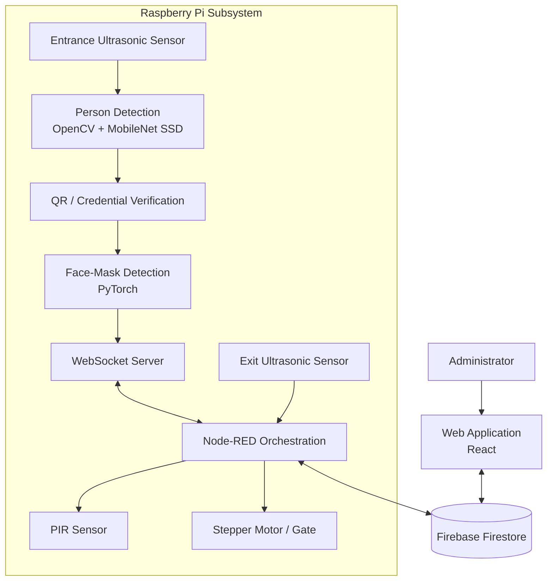

# Intelligent Access Control System

An intelligent, contactless access control system that combines **computer vision, IoT hardware, Firebase, and a web application** to automate entrance verification and monitor occupancy.

The system uses a Raspberry Pi to coordinate person detection, QR-code verification, face-mask detection, sensor input, and gate actuation. A web application provides an administrative interface for managing system settings, including the maximum permitted occupancy.

## Table of Contents

- [Overview](#overview)
- [Key Features](#key-features)
- [System Architecture](#system-architecture)
- [Access Control Workflow](#access-control-workflow)
- [Technology Stack](#technology-stack)
- [Repository Structure](#repository-structure)
- [Components](#components)
- [Configuration and Setup](#configuration-and-setup)
- [Security and Limitations](#security-and-limitations)
- [Acknowledgments](#acknowledgments)
- [Future Improvements](#future-improvements)

## Overview

This project explores how computer vision, embedded systems, and cloud-connected software can work together to automate access control.

Instead of relying entirely on manual verification, the system coordinates several stages of entrance screening. Sensors detect activity near the entrance, computer vision verifies the presence of a person, and the verification workflow checks the access credential and face-mask status. After successful verification, the system can trigger the gate mechanism and update occupancy information.

The project is divided into two main components:

- **Raspberry Pi subsystem:** Handles sensor input, computer vision, verification services, communication, and physical gate control.
- **Web application:** Provides the administrative interface and connects to Firebase for occupancy-related data and configuration.

## Key Features

- **Person detection:** Detects people at the entrance using OpenCV's deep-learning inference capabilities and a MobileNet SSD model.
- **QR-code verification:** Includes a credential verification stage before access is granted.
- **Face-mask detection:** Uses a PyTorch-based face-mask detection model to check mask compliance.
- **Occupancy management:** Uses Firebase Firestore to store current occupancy and the configured maximum occupancy.
- **Administrative web interface:** Provides a centralized interface for managing access-control settings.
- **Sensor-based automation:** Uses ultrasonic sensors to detect activity and a PIR sensor as part of the gate-control workflow.
- **Automated gate actuation:** Controls a stepper-motor mechanism through a Raspberry Pi-connected actuator.
- **Real-time communication:** Uses a Node.js WebSocket server to exchange messages with connected components.
- **Workflow orchestration:** Uses Node-RED to coordinate the different parts of the system.
- **Cloud-connected data:** Integrates Firebase with the local hardware workflow.

## System Architecture

The following diagram illustrates the main components and their intended interactions.



*Architecture overview: the diagram represents the major components and their intended data flow. Exact execution order and runtime behavior depend on the deployed Node-RED flow and individual services.*

## Access Control Workflow

The entrance workflow is organized into several stages:

1. **Entrance detection:** An ultrasonic sensor detects an approaching object.
2. **Person verification:** A computer-vision script analyzes camera input to determine whether a person is present.
3. **Credential verification:** The system checks the QR code or access credential.
4. **Mask verification:** The face-mask detection model evaluates the camera image.
5. **Access decision:** The orchestration workflow coordinates the next actions based on the verification result.
6. **Gate operation:** Following successful verification, the system activates the gate mechanism through the stepper-motor controller.
7. **Occupancy management:** Firebase Firestore stores occupancy-related information, including the current count and the configured maximum.

The exit subsystem contains an ultrasonic sensor intended to support occupancy decrementing. Its continuous monitoring behavior should be verified in the deployed workflow before being considered a completed feature.

## Technology Stack

| Category | Technologies |
|---|---|
| Embedded platform | Raspberry Pi |
| Programming languages | Python, JavaScript |
| Computer vision | OpenCV, MobileNet SSD |
| Deep learning | PyTorch |
| Web application | React |
| Cloud and database | Firebase, Cloud Firestore |
| Workflow orchestration | Node-RED |
| Communication | WebSockets, Node.js |
| Hardware input | Ultrasonic sensor, PIR sensor |
| Actuation | Stepper motor |
| Version control | Git, GitHub |

## Repository Structure

```text
intelligent-access-control-system/
Ôö£ÔöÇÔöÇ raspberry-pi/
Ôöé   Ôö£ÔöÇÔöÇ actuators/
Ôöé   Ôöé   ÔööÔöÇÔöÇ gate_stepper_motor.py
Ôöé   Ôö£ÔöÇÔöÇ communication/
Ôöé   Ôöé   ÔööÔöÇÔöÇ websocket-server/
Ôöé   Ôöé       Ôö£ÔöÇÔöÇ package.json
Ôöé   Ôöé       Ôö£ÔöÇÔöÇ package-lock.json
Ôöé   Ôöé       ÔööÔöÇÔöÇ websocket_server.js
Ôöé   Ôö£ÔöÇÔöÇ orchestration/
Ôöé   Ôöé   ÔööÔöÇÔöÇ node-red-flow.json
Ôöé   Ôö£ÔöÇÔöÇ sensors/
Ôöé   Ôöé   Ôö£ÔöÇÔöÇ pir_gate_sensor.py
Ôöé   Ôöé   ÔööÔöÇÔöÇ ultrasonic_exit_sensor.py
Ôöé   ÔööÔöÇÔöÇ vision/
Ôöé       Ôö£ÔöÇÔöÇ FaceMaskDetection/
Ôöé       Ôöé   Ôö£ÔöÇÔöÇ models/
Ôöé       Ôöé   Ôö£ÔöÇÔöÇ load_model/
Ôöé       Ôöé   Ôö£ÔöÇÔöÇ utils/
Ôöé       Ôöé   Ôö£ÔöÇÔöÇ pytorch_infer.py
Ôöé       Ôöé   Ôö£ÔöÇÔöÇ verification_server.py
Ôöé       Ôöé   ÔööÔöÇÔöÇ ws.py
Ôöé       ÔööÔöÇÔöÇ person_detection/
Ôöé           Ôö£ÔöÇÔöÇ entrance_person_detection.py
Ôöé           Ôö£ÔöÇÔöÇ coco.names
Ôöé           Ôö£ÔöÇÔöÇ frozen_inference_graph.pb
Ôöé           ÔööÔöÇÔöÇ ssd_mobilenet_v3_large_coco_2020_01_14.pbtxt
Ôö£ÔöÇÔöÇ web-app/
Ôö£ÔöÇÔöÇ .gitignore
ÔööÔöÇÔöÇ README.md
```

The `web-app/` directory contains the web application. Its internal structure and installation instructions should be documented in a dedicated README once the frontend dependencies and configuration have been verified.

## Components

### 1. Person Detection

The entrance detection module uses OpenCV's deep-learning functionality with a pretrained MobileNet SSD model to identify people in camera frames.

Relevant files:

- `raspberry-pi/vision/person_detection/entrance_person_detection.py`
- `raspberry-pi/vision/person_detection/frozen_inference_graph.pb`
- `raspberry-pi/vision/person_detection/ssd_mobilenet_v3_large_coco_2020_01_14.pbtxt`

### 2. Face-Mask Detection and Verification

The face-mask subsystem uses a PyTorch-based implementation to evaluate mask compliance. Its verification server and WebSocket helper connect the vision component to the broader access-control workflow.

Relevant files:

- `raspberry-pi/vision/FaceMaskDetection/verification_server.py`
- `raspberry-pi/vision/FaceMaskDetection/pytorch_infer.py`
- `raspberry-pi/vision/FaceMaskDetection/ws.py`

This subsystem incorporates code and model assets from the upstream FaceMaskDetection project. See its included license and README for attribution and applicable terms.

### 3. Sensors and Gate Actuation

The hardware-related scripts are separated by responsibility:

- `sensors/pir_gate_sensor.py` ÔÇö PIR-based detection.
- `sensors/ultrasonic_exit_sensor.py` ÔÇö exit-side ultrasonic sensing.
- `actuators/gate_stepper_motor.py` ÔÇö stepper-motor control.

The scripts are coordinated with the Node-RED workflow and must be configured for the actual Raspberry Pi GPIO connections and hardware setup.

### 4. WebSocket Communication

The Node.js WebSocket server is located at:

`raspberry-pi/communication/websocket-server/websocket_server.js`

It uses the `ws` package and listens on port `8080`. The Node-RED flow is configured to communicate with the local WebSocket endpoint.

### 5. Node-RED Orchestration

The exported workflow is stored in:

`raspberry-pi/orchestration/node-red-flow.json`

It coordinates the system's communication and automation logic, connecting the sensor, verification, database, and actuator stages.

### 6. Firebase Integration

Firebase Firestore stores occupancy-related values:

- `RT_data/cur` ÔÇö current occupancy.
- `RT_data/max` ÔÇö configured maximum occupancy.

The web application and Raspberry Pi workflow use these values for occupancy management. Correct enforcement of the maximum limit depends on the deployed application and Node-RED logic.

## Configuration and Setup

This repository contains source code, model assets, and a Node-RED flow export. A working installation also requires compatible hardware, Python and Node.js dependencies, Firebase configuration, and correct network and GPIO settings.

### Prerequisites

- Raspberry Pi with a compatible Raspberry Pi OS installation.
- Camera supported by the configured vision software.
- Required ultrasonic and PIR sensors.
- Stepper motor and compatible driver circuitry.
- Python and the dependencies required by the vision and hardware scripts.
- Node.js and npm for the WebSocket server.
- Node-RED with the required nodes and credentials.
- A Firebase project with the necessary Firestore configuration.
- The dependencies required by the React web application.

### 1. Clone the Repository

```bash
git clone https://github.com/HibaBenNasr/intelligent-access-control-system.git
cd intelligent-access-control-system
```

### 2. Set Up the Raspberry Pi Components

Deploy the `raspberry-pi/` directory to the Raspberry Pi and install the Python packages required by each component.

The exact dependencies, operating-system compatibility, camera configuration, and GPIO pin assignments should be verified against the individual scripts and hardware.

### 3. Configure the WebSocket Server

```bash
cd raspberry-pi/communication/websocket-server
npm install
node websocket_server.js
```

The server is configured to listen on port `8080`. Ensure the Node-RED flow uses a reachable endpoint when the components run on different devices.

### 4. Import the Node-RED Flow

Import `raspberry-pi/orchestration/node-red-flow.json` into Node-RED.

Configure any required nodes, Firebase credentials, hardware commands, and connection settings before deploying the flow.

### 5. Configure Firebase and the Web Application

Configure the web application and Node-RED to use the appropriate Firebase project. Install the frontend dependencies from the `web-app/` directory using its package manifest.

**Important:** A complete, reproducible setup requires the actual frontend start/build commands and Firebase initialization steps to be documented from the web application's configuration files.

## Security and Limitations

This project is an educational and portfolio implementation. It should not be deployed as a production security system without further testing and hardening.

- The current QR verification implementation uses a hardcoded test code. Replace it with secure, configurable credential verification before real-world use.
- Protect Firebase credentials and enforce appropriate database security rules.
- Do not commit private keys, service-account files, passwords, or environment-specific secrets.
- Verify that maximum occupancy is checked before granting access and that concurrent entrance and exit events cannot produce incorrect counts.
- Confirm that the exit sensor is continuously monitored if continuous occupancy decrementing is required.
- Validate sensor behavior, motor limits, failure handling, and safe gate operation on the actual hardware.
- Restrict WebSocket access to trusted clients and configure appropriate network protections.
- Test negative cases, including invalid credentials, failed mask verification, unavailable services, and full occupancy.

## Acknowledgments

The face-mask detection component includes code and model assets derived from the upstream [AIZOOTech/FaceMaskDetection](https://github.com/AIZOOTech/FaceMaskDetection) project. Please refer to the included license and upstream documentation for the applicable attribution and usage terms.

## Future Improvements

Potential improvements include:

- Secure, configurable QR-code or access-token verification.
- Explicit and tested maximum-occupancy enforcement.
- Reliable continuous exit monitoring and occupancy synchronization.
- Improved error handling and service health monitoring.
- Authentication and role-based authorization for administrators.
- Automated tests for the verification and occupancy workflows.
- Deployment documentation, screenshots, and an end-to-end demonstration.
- More detailed logging and audit trails for access decisions.

## Author

**Hiba Ben Nasr**

- GitHub: [@HibaBenNasr](https://github.com/HibaBenNasr)
- Repository: [Intelligent Access Control System](https://github.com/HibaBenNasr/intelligent-access-control-system)
