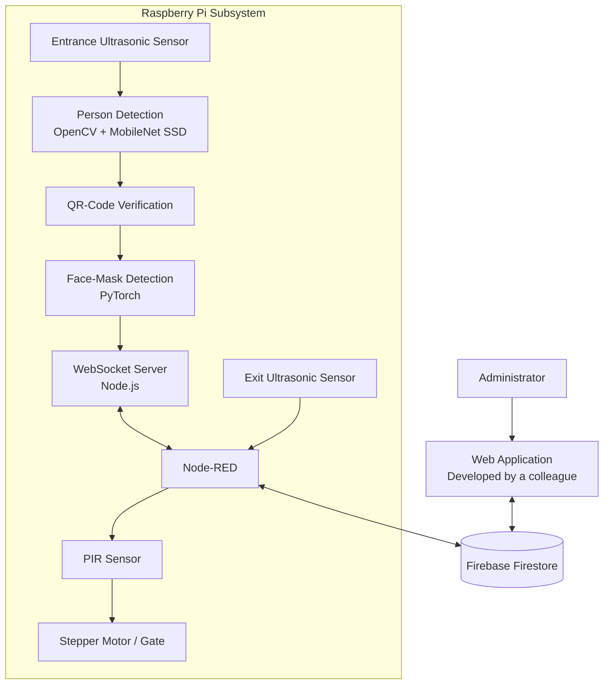

# Intelligent Access Control System

An intelligent, contactless access control system that combines **computer vision, machine learning, IoT hardware, and cloud-connected services** to automate entrance verification and monitor occupancy.

The system uses a Raspberry Pi to coordinate person detection, QR-code verification, face-mask detection, sensor input, and physical gate control. Firebase Firestore stores occupancy information and the maximum permitted number of people, while Node-RED orchestrates communication between the different components.

The project also includes a web-based administrative interface developed by a colleague, allowing administrators to manage system settings, including the maximum occupancy.

## Table of Contents

- [Project Overview](#project-overview)
- [Key Features](#key-features)
- [System Architecture](#system-architecture)
- [Access Control Workflow](#access-control-workflow)
- [Technology Stack](#technology-stack)
- [My Contributions](#my-contributions)
- [Repository Structure](#repository-structure)
- [Main Components](#main-components)
- [Configuration and Setup](#configuration-and-setup)
- [Limitations and Security Considerations](#limitations-and-security-considerations)
- [Acknowledgments](#acknowledgments)
- [Future Improvements](#future-improvements)

## Project Overview

The objective of this project is to develop an automated access control system that combines computer vision, embedded systems, and cloud services to manage entrance authorization and occupancy.

The system follows a multi-stage verification process. Sensors detect activity near the entrance, and computer vision verifies the presence of a person. The system then performs the required access verification, including QR-code and face-mask checks.

Access is granted only when the verification conditions are satisfied and the current occupancy allows another person to enter. The gate mechanism is then activated, and occupancy information is updated in Firebase Firestore.

The project consists of two main subsystems:

- **Raspberry Pi subsystem:** Responsible for computer vision, sensor integration, access verification, communication, workflow orchestration, and physical gate control.
- **Web application:** Provides an administrative interface for managing system settings and occupancy information. It was developed by a colleague and is included in this repository as part of the overall project.

## Key Features

- **Person Detection:** Detects the presence of people using OpenCV and a pretrained MobileNet SSD model.
- **QR-Code Verification:** Includes a QR-code-based credential verification stage.
- **Face-Mask Detection:** Uses a PyTorch-based deep-learning implementation to evaluate face-mask compliance.
- **Occupancy Management:** Tracks the number of people inside the facility using Firebase Firestore.
- **Maximum Occupancy Control:** Compares current occupancy against the maximum capacity configured by the administrator.
- **Sensor Integration:** Uses ultrasonic sensors and a PIR sensor to detect movement and support entrance and exit operations.
- **Automated Gate Control:** Controls a stepper-motor mechanism connected to the Raspberry Pi.
- **Real-Time Communication:** Uses a Node.js WebSocket server to exchange information between system components.
- **Workflow Orchestration:** Uses Node-RED to coordinate the different services and hardware operations.
- **Cloud Integration:** Uses Firebase Firestore to synchronize occupancy information and system configuration.

## System Architecture

The following diagram illustrates the main components and their interactions.



*The diagram provides a high-level representation of the system architecture and communication between its components.*


## Gate Design (3D Models)

The following 3D models illustrate the proposed physical design of the access control system, showing the two separate entrance and exit structures.

These designs represent the initial hardware concept and the intended layout of the gate mechanisms.

### Entrance Gate

)

### Exit Gate

)


## Access Control Workflow

### Entrance Process

1. **Movement Detection:** An ultrasonic sensor detects movement approximately 40 cm from the entrance, triggering the system.
2. **Person Detection:** A computer-vision script analyzes the camera input to verify the presence of a person.
3. **Access Verification:** The system performs the required verification stages, including QR-code credential verification and face-mask detection.
4. **Occupancy Check:** The system retrieves the current occupancy and maximum permitted occupancy from Firebase Firestore.
5. **Access Authorization:** Entry is permitted only when the verification conditions are satisfied and the occupancy limit has not been reached.
6. **Gate Activation:** A PIR sensor detects the person's approach to the gate, allowing the stepper-motor mechanism to operate.
7. **Occupancy Update:** The number of people inside the facility is updated in Firebase Firestore.

### Exit Process

A second ultrasonic sensor was used in the prototype to detect movement at the exit and update the occupancy count accordingly.

## Technology Stack

| Category | Technologies |
|---|---|
| Embedded Platform | Raspberry Pi |
| Programming Languages | Python, JavaScript |
| Computer Vision | OpenCV, MobileNet SSD |
| Deep Learning | PyTorch |
| Database & Cloud | Firebase Firestore |
| Workflow Automation | Node-RED |
| Communication | WebSockets, Node.js |
| Hardware Sensors | Ultrasonic Sensor, PIR Sensor |
| Actuation | Stepper Motor |
| Web Application | React (developed by a colleague) |
| Version Control | Git, GitHub |

## My Contributions

My main responsibility in this project was developing the **Raspberry Pi subsystem**, focusing on the integration of computer vision, hardware components, and communication services.

My contributions included:

- Implementing person detection using OpenCV and MobileNet SSD.
- Integrating the face-mask detection component into the access verification workflow.
- Developing Python scripts for sensor interaction and hardware control.
- Implementing the stepper-motor gate control.
- Developing the Node.js WebSocket server for communication.
- Designing and configuring the Node-RED workflow to coordinate the different system components.
- Integrating Firebase Firestore into the Raspberry Pi workflow for occupancy management.

**Regarding the web application:** The React-based administrative interface was developed by a colleague. It is included in this repository to provide the complete project context, but its development was not part of my individual contribution.

## Repository Structure

```text
intelligent-access-control-system/
│
├── raspberry-pi/
│   ├── actuators/
│   │   └── gate_stepper_motor.py
│   │
│   ├── communication/
│   │   └── websocket-server/
│   │       ├── package.json
│   │       ├── package-lock.json
│   │       └── websocket_server.js
│   │
│   ├── orchestration/
│   │   └── node-red-flow.json
│   │
│   ├── sensors/
│   │   ├── pir_gate_sensor.py
│   │   └── ultrasonic_exit_sensor.py
│   │
│   └── vision/
│       ├── FaceMaskDetection/
│       │   ├── models/
│       │   ├── load_model/
│       │   ├── utils/
│       │   ├── pytorch_infer.py
│       │   ├── verification_server.py
│       │   └── ws.py
│       │
│       └── person_detection/
│           ├── entrance_person_detection.py
│           ├── coco.names
│           ├── frozen_inference_graph.pb
│           └── ssd_mobilenet_v3_large_coco_2020_01_14.pbtxt
│
├── web-app/
│   └── (Web application developed by a colleague)
│
├── .gitignore
└── README.md
```

## Main Components

### 1. Person Detection

The person-detection module uses OpenCV's deep-learning functionality with a pretrained MobileNet SSD model to identify people in camera frames.

**Relevant files:**
- `raspberry-pi/vision/person_detection/entrance_person_detection.py`
- `raspberry-pi/vision/person_detection/frozen_inference_graph.pb`
- `raspberry-pi/vision/person_detection/ssd_mobilenet_v3_large_coco_2020_01_14.pbtxt`

### 2. Face-Mask Detection

The face-mask detection subsystem uses a PyTorch-based implementation to evaluate mask compliance.

Its verification server and WebSocket helper connect the detection component to the broader access-control workflow.

**Relevant files:**
- `raspberry-pi/vision/FaceMaskDetection/verification_server.py`
- `raspberry-pi/vision/FaceMaskDetection/pytorch_infer.py`
- `raspberry-pi/vision/FaceMaskDetection/ws.py`

The implementation is based on the external FaceMaskDetection project referenced in the acknowledgments.

### 3. Sensors and Gate Actuation

The hardware-related Python scripts handle sensor input and physical gate control.

- `sensors/pir_gate_sensor.py`: PIR-based movement detection near the gate.
- `sensors/ultrasonic_exit_sensor.py`: Ultrasonic sensing for exit detection.
- `actuators/gate_stepper_motor.py`: Stepper-motor control for gate operation.

These components are coordinated through the Node-RED workflow.

### 4. WebSocket Communication

The Node.js WebSocket server enables communication between the Raspberry Pi services and the Node-RED workflow.

**Location:**

`raspberry-pi/communication/websocket-server/websocket_server.js`

The server uses the `ws` package and listens on port `8080`.

### 5. Node-RED Orchestration

Node-RED coordinates the communication and automation logic between the different components, connecting sensor events, verification services, Firebase, and gate-control operations.

**Location:**

`raspberry-pi/orchestration/node-red-flow.json`

### 6. Firebase Integration

Firebase Firestore stores occupancy-related information:

| Database Path | Description |
|---|---|
| `RT_data/cur` | Current occupancy |
| `RT_data/max` | Maximum permitted occupancy |

The Raspberry Pi workflow uses these values to manage access according to the configured capacity. The web application allows the administrator to modify the maximum occupancy.

## Configuration and Setup

This repository contains source code, model assets, and a Node-RED flow export. Running the complete system requires compatible hardware, software dependencies, Firebase configuration, and appropriate network and GPIO settings.

### Prerequisites

- Raspberry Pi with a compatible Raspberry Pi OS installation.
- Camera supported by the computer-vision scripts.
- Ultrasonic and PIR sensors.
- Stepper motor and compatible driver.
- Python and the required Python packages.
- Node.js and npm.
- Node-RED with the required nodes and credentials.
- Firebase project with Firestore configured.

### 1. Clone the Repository

```bash
git clone https://github.com/HibaBenNasr/intelligent-access-control-system.git
cd intelligent-access-control-system
```

### 2. Configure the Raspberry Pi Components

Deploy the `raspberry-pi/` directory to the Raspberry Pi and install the dependencies required by the individual Python scripts.

Configure the camera, GPIO pins, sensors, and motor according to your hardware setup.

### 3. Configure the WebSocket Server

```bash
cd raspberry-pi/communication/websocket-server
npm install
node websocket_server.js
```

The server listens on port `8080`.

### 4. Import the Node-RED Flow

Import `raspberry-pi/orchestration/node-red-flow.json` into Node-RED.

Configure the required nodes, Firebase credentials, and communication endpoints before deploying the workflow.

### 5. Configure Firebase

Set up a Firebase project and configure the required Firestore database structure.

Ensure that the Raspberry Pi workflow and web application use the appropriate Firebase configuration.

**Note:** The web application's installation and execution instructions depend on its own configuration and dependencies.

## Limitations and Security Considerations

This project was developed as an academic project and is intended for educational and demonstration purposes. It should not be considered a production-ready security system without additional testing and hardening.

- The current QR verification implementation uses a hardcoded test code.
- Firebase credentials and database access rules must be properly secured.
- Maximum-occupancy enforcement and simultaneous entrance/exit events require further validation.
- Exit detection and continuous occupancy synchronization should be tested on the deployed hardware.
- Sensor reliability and motor safety should be validated under real operating conditions.
- WebSocket communication should be restricted to trusted clients.
- Error handling and recovery mechanisms should be improved for unavailable services or failed verification stages.

## Acknowledgments

Special thanks to the developers of the following open-source project, which was used as the basis for the face-mask detection component:

- **[AIZOOTech/FaceMaskDetection](https://github.com/AIZOOTech/FaceMaskDetection)** – Face-mask detection implementation.

The original repository's license and attribution requirements should be respected when using or redistributing its code and assets.

## Future Improvements

Potential improvements include:

- Replacing the hardcoded QR code with secure credential verification.
- Strengthening occupancy synchronization and maximum-capacity enforcement.
- Improving continuous exit detection.
- Adding better error handling and system monitoring.
- Implementing stronger authentication and authorization.
- Adding automated tests for the access-control workflow.
- Providing a complete deployment guide and system demonstration.

## Author

**Hiba Ben Nasr**

- GitHub: [@HibaBenNasr](https://github.com/HibaBenNasr)
- Repository: [Intelligent Access Control System](https://github.com/HibaBenNasr/intelligent-access-control-system)
